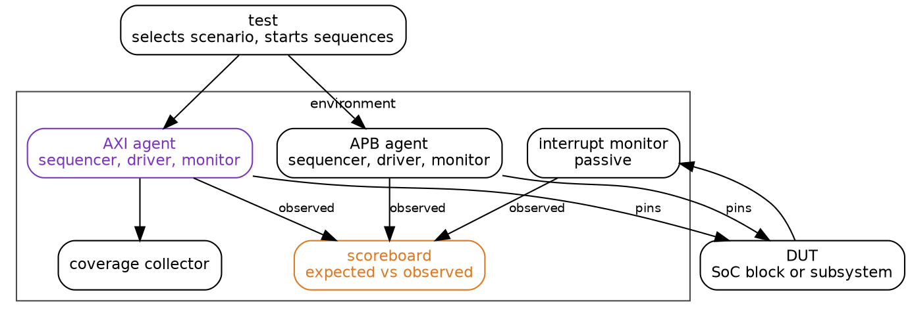

Title: SoC Intermediate 06: SoC verification with UVM
Date: 2026-10-12
Category: Engineering
Tags: SoC, Hardware, Electronics, RTL, UVM, Verification, SystemVerilog, Coverage, ASIC
Slug: soc-intermediate-06-soc-verification-with-uvm
Author: morganp
Summary: Why a green regression proves only what its checkers can notice, and how a UVM environment is built so that agents, scoreboards, assertions and functional coverage expose the bugs a directed test never asks about.
Status: published

[]({static}/images/SoC/ArticleI06/00-verification-environment-hero-HQ.png)

*Series: Intermediate SoC Design | Article 6 of 10*

---

## The regression that stayed green

The regression had been green for eleven weeks. Forty thousand tests ran every night against the DMA (direct memory access) controller, every scoreboard matched, and the coverage report sat at ninety-eight percent. Then the first firmware build that chained descriptors hung the block on its first transfer.

The descriptor started eight bytes below a 4 KB boundary. An AXI (Advanced eXtensible Interface) burst may not cross that boundary, so the controller had to split the first burst in two. The splitting logic had run millions of times with start addresses far from a boundary. It had never run this close to one with a length this large.

Nothing in the environment was broken. The tests were legal, the checkers were correct for the cases they covered, and the report was accurate. The environment never asked the question.

This article explains how a UVM (Universal Verification Methodology) environment is built, why its checkers and coverage decide what a green result means, and how to read a verification plan critically. It targets engineers who write or review SoC (system on chip) testbenches, and anyone handed a regression report and asked whether a block is ready.

---

## Why directed tests run out

A directed test checks a scenario the engineer already thought of. A typical DMA test follows a fixed script:

1. Reset the DMA.
2. Program the source address.
3. Program the destination address.
4. Program the length.
5. Start the transfer.
6. Check the completion interrupt.

This test is useful and it is not enough. It covers one path through a space with many dimensions, and the combinations nobody listed are the ones that fail:

- Backpressure during the last AXI beat
- An interrupt masked while completion occurs
- A descriptor crossing a 4 KB boundary
- Reset during an active transfer
- Two channels contending for the same target
- An error response halfway through a burst

Constrained-random generation explores that space instead. The testbench builds many legal variations of the stimulus, and checkers and coverage decide whether the variations meant anything. Random does not mean unplanned: the constraints and the coverage model encode the verification intent.

```systemverilog
constraint legal_dma_c {
    length inside {[1:4096]};
    src_addr[1:0] == 0;
    dst_addr[1:0] == 0;
    burst_len inside {1, 4, 8, 16};
}
```

Randomisation earns its place on the awkward cases: address alignment and boundaries, backpressure insertion, interrupt masking, reset timing, arbitration weights, error responses and descriptor chain shapes.

---

## Anatomy of a UVM environment

UVM is a SystemVerilog class library for building reusable constrained-random environments. It separates three jobs: generating stimulus, driving it onto pins, and judging the result.



The DUT (device under test) is the block being verified. Each agent bundles a sequencer, a driver and a monitor for one interface, so the protocol knowledge lives in one reusable place. An APB (Advanced Peripheral Bus) agent drops into any project that has an APB port.

| Component | Role |
|---|---|
| `uvm_test` | Selects the scenario and configures the environment |
| `uvm_env` | Holds the reusable verification components |
| `uvm_agent` | Bundles the driver, sequencer and monitor for one protocol |
| `uvm_sequence` | Generates a stream of transactions |
| `uvm_sequencer` | Arbitrates sequence items on their way to a driver |
| `uvm_driver` | Turns transactions into pin-level activity |
| `uvm_monitor` | Watches pins and publishes transactions |
| `uvm_scoreboard` | Compares expected and observed results |

Stimulus is described at transaction level. A sequence item represents one abstract AXI write, with the legal ranges written as constraints:

```systemverilog
class axi_write_item extends uvm_sequence_item;
    rand bit [31:0] addr;
    rand bit [7:0]  len;
    rand bit [2:0]  size;
    rand bit [3:0]  qos;
    rand bit [31:0] data[];

    constraint aligned_c {
        addr[1:0] == 2'b00;
    }

    constraint length_c {
        len inside {[0:15]};
        data.size() == int'(len) + 1;
    }

    `uvm_object_utils(axi_write_item)
endclass
```

The driver turns this item into AXI handshakes. The monitor turns observed handshakes back into transaction objects, so the scoreboard and the coverage collector work on the same abstract view as the sequences.

UVM components move through phases in a fixed order:

```dot
digraph UvmPhases {
    rankdir=LR;
    node [shape=box, style=rounded, fontname="Helvetica", fontsize=10];

    Build   [label="build_phase\ncreate components"];
    Connect [label="connect_phase\nwire TLM (transaction-level modelling) ports"];
    EndElab [label="end_of_elaboration"];
    Run     [label="run_phase\nparallel stimulus", color="#7B35C2", fontcolor="#7B35C2"];
    Extract [label="extract_phase"];
    Check   [label="check_phase"];
    Report  [label="report_phase"];

    Build -> Connect -> EndElab -> Run -> Extract -> Check -> Report;
}
```



Components are created in `build_phase` and wired together in `connect_phase`. Active stimulus runs in `run_phase`, and the remaining phases collect and report results. The methodology is verbose, and that verbosity buys reuse: AXI, APB, interrupt, reset and memory agents carry from one project to the next.

---

## Checking is the hard part

Stimulus is the easy half of verification. A random sequence generates thousands of transactions an hour, and none of them mean anything until something judges the outcome.

The three roles stay separate on purpose. The driver sends legal or deliberately illegal stimulus and never decides whether the DUT behaved correctly. The monitor observes and never changes a pin. The scoreboard compares the observed result with a prediction.

The prediction comes from a reference model. A model works at a useful level of abstraction and does not mirror the RTL (register transfer level) cycle by cycle. For a FIFO (first in, first out buffer) the model is a queue:

```systemverilog
class fifo_model;
    bit [31:0] q[$];

    function void push(bit [31:0] data);
        q.push_back(data);
    endfunction

    function bit [31:0] pop();
        return q.pop_front();
    endfunction
endclass
```

For a DMA controller the model is larger. It fetches descriptors, increments addresses, applies byte enables, handles errors and updates interrupt status. It predicts architectural results, such as which bytes land where and which interrupt rises, and leaves the pipeline timing to the RTL.

Assertions add checks that run on every cycle. They suit local rules that must always hold, such as a bus protocol, an arbiter grant or a state machine transition. AXI requires a valid payload to stay stable while it waits for the other side:

```wavedrom
{
  "signal": [
    {"name": "ACLK",    "wave": "P........."},
    {"name": "AWVALID", "wave": "0.1....0.."},
    {"name": "AWREADY", "wave": "0.....1..."},
    {"name": "AWADDR",  "wave": "x.2.3...x.", "data": ["A0", "A1"]}
  ],
  "head": {"text": "AWADDR changes at cycle 4 while AWVALID is still waiting for AWREADY"}
}
```

```systemverilog
property valid_payload_stable;
    @(posedge ACLK) disable iff (!ARESETn)
    AWVALID && !AWREADY |=> AWVALID && $stable(AWADDR);
endproperty

assert property (valid_payload_stable)
    else `uvm_error("AXI", "AW payload changed while stalled");
```

Every checker in the environment answers a question somebody wrote down. A test passes when none of those questions finds a difference. That proves the checkers saw nothing wrong, and says nothing about the bugs no checker was written to see.

[]({static}/images/SoC/ArticleI06/01-checker-gap-HQ.png)

Apply that to the hung DMA. The scoreboard compared data and interrupt status, and both were correct for every transfer that finished. The hung transfer never finished, so it never produced a result to compare. The environment had no check that told slow from stuck, and no assertion on the 4 KB rule. A liveness timeout would have flagged the hang on the first night. A protocol assertion would have flagged the first bad burst.

---

## Coverage and the verification plan

Coverage reports what the tests exercised. Code coverage records which lines and branches of the RTL executed. Functional coverage records whether the scenarios in the verification plan happened, and it needs the engineer to define them as bins.

```systemverilog
covergroup axi_burst_cg with function sample(axi_write_item item);
    burst_len: coverpoint item.len {
        bins single = {0};
        bins short  = {[1:3]};
        bins long   = {[4:15]};
    }

    burst_size: coverpoint item.size {
        bins word  = {2};
        bins dword = {3};
    }

    qos: coverpoint item.qos {
        bins low  = {[0:3]};
        bins mid  = {[4:11]};
        bins high = {[12:15]};
    }

    len_x_size: cross burst_len, burst_size;
endgroup
```

The report in the opening story sat at ninety-eight percent of the bins somebody defined. No bin existed for a start address within one burst of a 4 KB boundary. A coverage number measures progress against the bins that exist, so the quality of the bins limits the quality of the number.

A verification plan fixes that by working from requirements. Each requirement maps to the method that proves it:

| Requirement | Method |
|---|---|
| AXI writes support INCR bursts | Random AXI sequence and coverage |
| DMA raises a completion interrupt | Scoreboard and interrupt monitor |
| An illegal descriptor reports an error | Directed error test and assertion |
| Reset clears an active channel | Reset stress sequence and register checks |
| No payload changes under stall | AXI protocol assertions |
| No burst crosses a 4 KB boundary | Protocol assertion and an address-offset cross |

Write the plan before the random tests. Without it, coverage numbers turn decorative, and a table like the one above shows which requirement has no row.

---

## Beyond the block

A block-level environment checks one design in isolation. Subsystem and full-chip verification add concerns that no single block owns:

- Register address maps
- Bus decode errors
- Interrupt routing
- Boot ROM and firmware sequences
- Power domain isolation
- Reset ordering
- Coherency and DMA interactions
- Performance counters and QoS (quality of service)

Full-chip simulation is slow, so teams spread the work across several platforms. Block-level UVM covers the detail, subsystem tests cover the connections, and emulation and FPGA prototypes run firmware at a speed simulation cannot reach. The checkers matter at every level, and each platform needs its own answer to which check would notice a failure.

---

## Verification checklist

1. Write a verification plan before writing random tests.
2. Use reusable agents for standard protocols.
3. Keep monitors passive and free of side effects.
4. Put expected behaviour in scoreboards or reference models.
5. Add a liveness timeout wherever a scoreboard waits for a result.
6. Track functional coverage against requirements, not against the bins that happen to exist.
7. Add assertions for local invariants and protocol rules.
8. Run seed regression and preserve failing seeds.
9. Treat every waiver as a reviewed engineering decision.

Before trusting a green report, pick one bug the design could plausibly have and trace which checker would catch it. When no checker would, the report needs another row, not more tests.

---

*Previous: [Article I-05: Clock domain crossing techniques]({filename}../2026-10-03_SoC_Intermediate_05_Clock_Domain_Crossing/2026-10-03_SoC_Intermediate_05_Clock_Domain_Crossing.md)*
*Next: Intermediate Article 07, DMA controller architecture*
