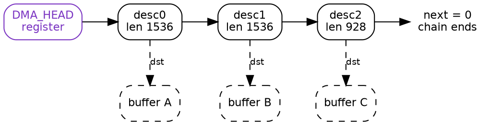
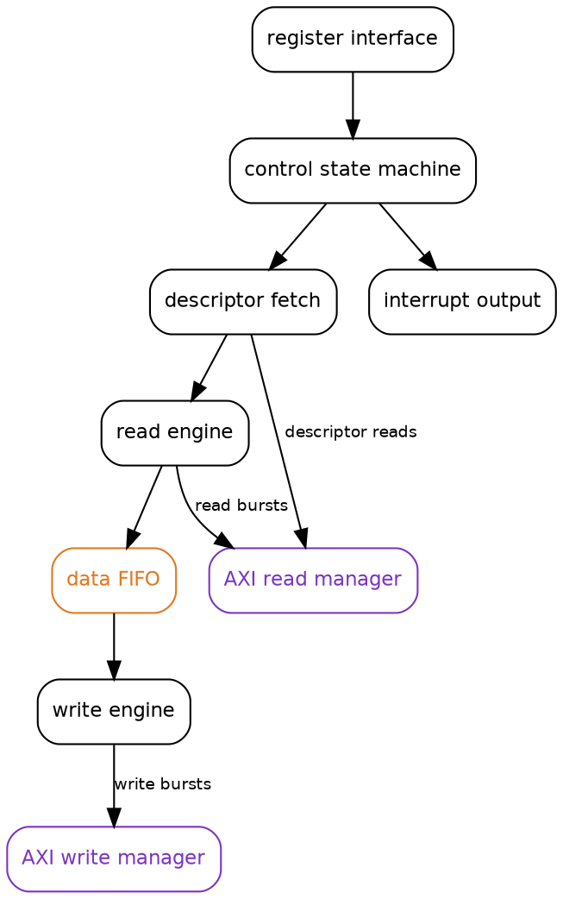
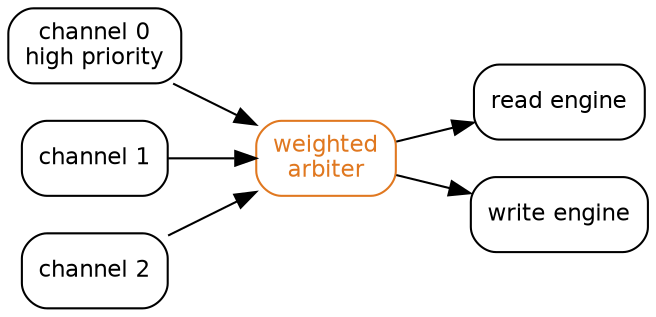
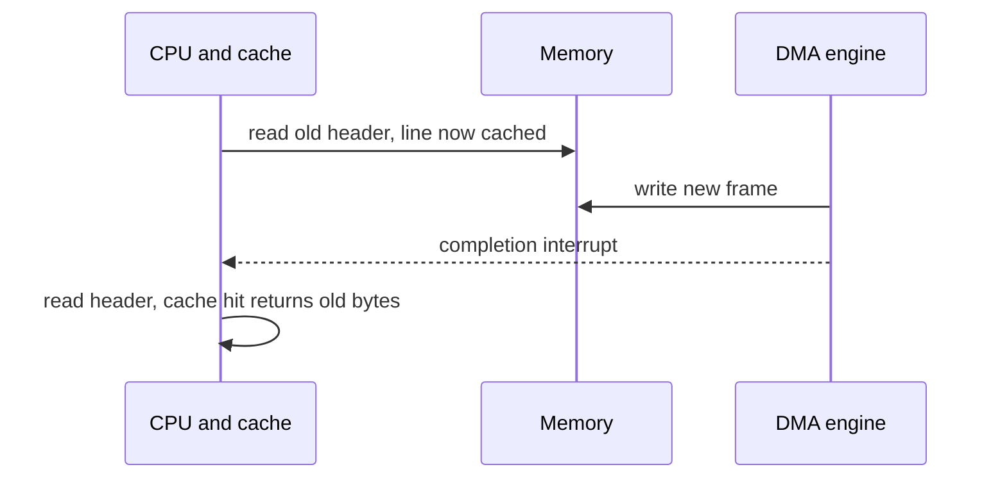

Title: SoC Intermediate 07: DMA controller architecture
Date: 2026-11-04
Category: Engineering
Tags: SoC, Hardware, Electronics, RTL, DMA, AXI, Cache, Scatter-Gather
Slug: soc-intermediate-07-dma-controller-architecture
Author: morganp
Summary: How a DMA engine moves data without the CPU, from descriptor chains and burst splitting to channel arbitration, and why a completion interrupt does not mean the CPU can see the data.
Status: published

*Series: Intermediate SoC Design | Article 7 of 10*

---

## The packet that arrived intact and read as garbage

The completion interrupt fired. The descriptor status read done, and the length field matched the frame on the wire. The driver passed the buffer up the network stack, and the stack dropped the frame because of a bad header.

A hex dump showed the first 64 bytes belonging to the previous packet. Every later byte belonged to the new one. The DMA engine had written all of them.

This article explains how a DMA (direct memory access) controller moves data without the CPU (central processing unit). It covers register-programmed transfers, descriptor chains, burst formation and channel arbitration. It targets engineers who design a DMA engine, and engineers who write the driver that programs one.

---

## Why a copy loop loses

A processor copies memory one word at a time:

```c
for (i = 0; i < len; i++)
    dst[i] = src[i];
```

Each iteration executes a load, a store and a loop branch. The data passes through the register file and the data cache, and it displaces lines the program still needs. The core spends power and issue slots on work that transforms no data.

A DMA engine moves the copy into hardware. Software describes the transfer, and the engine runs it as AXI (Advanced eXtensible Interface) read bursts, a buffer, and AXI write bursts. The CPU receives one interrupt at the end.

The simplest engine takes the description through registers:

| Offset | Register | Purpose |
|---|---|---|
| `0x00` | `CTRL` | Enable, start and interrupt enable bits |
| `0x04` | `STATUS` | Busy, done and error flags |
| `0x08` | `SRC_ADDR` | Source address |
| `0x0C` | `DST_ADDR` | Destination address |
| `0x10` | `LEN_BYTES` | Transfer length in bytes |
| `0x14` | `BURST_CFG` | Maximum burst length and QoS (quality of service) value |
| `0x18` | `IRQ_STATUS` | Interrupt flags, write one to clear |

The `IRQ_STATUS` flags clear when software writes a 1 to them. Software writes back only the bits it handled, so a completion that arrives between the read and the write keeps its flag.

Register programming suits one large transfer and fails on continuous traffic. A gigabit Ethernet port receives about 81,000 frames a second at 1500 bytes. Each frame would cost an interrupt, four register writes and a start command, and the engine sits idle between frames while software catches up.

---

## Descriptors and scatter-gather

A descriptor moves the transfer description out of registers and into memory. Software builds a list of descriptors and gives the engine the address of the first one.

```c
struct dma_desc {
    uint64_t src;
    uint64_t dst;
    uint32_t len;
    uint32_t control;   /* version, OWN, DONE, ERROR, IRQ_ON_DONE */
    uint64_t next;      /* address of the next descriptor, 0 ends the chain */
};
```

The engine fetches a descriptor, runs the transfer and follows `next` until it reads zero. Software and engine never share a register for each transfer, so the engine runs back to back.

Operating systems rarely hand a driver one large contiguous buffer. A 4000-byte frame arrives in three 1536-byte buffers, and the last one holds 928 bytes. Scatter-gather lets one chain of descriptors place that logical stream across non-contiguous memory.



The `control` word carries the handshake between software and engine. Software sets the OWN bit when a descriptor is ready. The engine clears OWN and sets DONE or ERROR when the transfer ends, and it writes the descriptor back to memory. Software scans for descriptors it owns again and recycles them without reading an engine register.

A version field and reserved bits in `control` let a later engine extend the format. Old drivers keep working because they never set the new bits.

---

## Inside the engine

### Read engine, FIFO and write engine

A memory-to-memory engine has two halves that run independently. The read engine issues AXI read bursts and pushes the returning data into a FIFO (first in, first out buffer). The write engine pops the FIFO and issues AXI write bursts.



The two AXI ports are a manager port for reads and a manager port for writes. Older AXI documents call a manager a master and a subordinate a slave. The signal names are unchanged.

The FIFO decouples read latency from write latency. Without it, every stall on the read side would stall the write side, and the reverse.

```wavedrom
{
  "signal": [
    {"name": "clk",        "wave": "P..........."},
    {"name": "RVALID",     "wave": "0.1...0....."},
    {"name": "fifo_level", "wave": "3..33..33...", "data": ["0", "1", "2", "1", "0"]},
    {"name": "WVALID",     "wave": "0...1...0..."}
  ],
  "head": {"text": "Four read beats fill the FIFO while the write side drains it"}
}
```

Two limits set the FIFO depth. Many designs start a write burst only when the FIFO holds every beat of it, so the write channel never idles halfway through a burst. The FIFO must also cover the read latency. A read latency of 40 cycles on a 128-bit bus needs 40 beats of 16 bytes, or 640 bytes, to keep the interconnect busy.

### Burst formation

Burst quality sets DMA throughput, and the engine must emit legal AXI for any address and length that software supplies. An AXI burst must not cross a 4 KB boundary. The engine splits at the boundary:

```c
bytes = 4096 - (addr & 0xFFF);          /* distance to the next 4 KB boundary */
if (bytes > remaining) bytes = remaining;
if (bytes > max_burst) bytes = max_burst;
```

The descriptor in the previous article started eight bytes below a boundary. The first burst carries those eight bytes, and the second starts exactly on the boundary.

Unaligned addresses need byte strobes. Take a copy of 35 bytes from `0x1003` to `0x8005` on a 32-bit bus. The source offset within a word is 3 and the destination offset is 1, so the engine rotates the data by two byte lanes between the read and the write. The read side issues 10 word reads from `0x1000`. The write side issues 9 word writes from `0x8004`:

| Write word | Address | Byte strobes | Bytes written |
|---|---|---|---|
| First | `0x8004` | `1110` | 3 |
| Middle (7 words) | `0x8008` to `0x8023` | `1111` | 28 |
| Last | `0x8024` | `1111` | 4 |

The total is 35 bytes. The read and write sides see different beat counts, which is another reason the FIFO sits between them.

---

## Sharing the engine between channels

A multi-channel controller shares one read engine and one write engine. The arbiter decides which channel issues next, and its policy sets latency and fairness.



Four policies cover most designs:

- Fixed priority serves the highest channel first and can starve the rest.
- Round-robin gives each channel a turn and shares bandwidth equally.
- Weighted round-robin gives each channel a share in proportion to its weight.
- Bandwidth or deadline reservation guarantees a rate or a latency to a channel.

Real-time streams need the last option. A display fetch that arrives late shows as a glitch even when the average bandwidth is fine, so a fair share does not protect it.

Bound the outstanding transactions for each channel. Each outstanding read reserves FIFO space for its returning data, so the bound also sets the FIFO depth. Without a bound, one busy channel fills the interconnect and starves the others.

---

## Where the DMA and the CPU disagree about memory

The frame in the opening was intact in memory. The CPU read a stale copy from its data cache.

The driver had read the header of the previous packet from this buffer, so the first 64-byte cache line stayed in the cache. The DMA engine wrote the new frame straight to memory, and the cache was not told. The CPU read the first line from the cache and every later line from memory.



The completion interrupt reports that the DMA engine finished writing memory. It makes no statement about the CPU cache. A DMA engine is a second manager on the interconnect, and it sees memory without the caches.

On a non-coherent interconnect, software closes the gap with cache maintenance:

- Before the DMA engine reads a CPU-produced buffer, the CPU cleans the cache lines to memory.
- After the DMA engine writes a buffer, the CPU invalidates the cache lines before it reads them.

A coherent interconnect lets the DMA engine snoop the CPU caches and removes most of these calls, at the cost of coherent port support in the fabric.

The same view of memory governs faults. The engine must handle each of these without hanging:

- An AXI subordinate error response or a decode error response on a data burst.
- A fault while fetching a descriptor.
- A misaligned descriptor or an illegal length.
- A channel disabled in the middle of a transfer.

On a fault, the engine stops the channel, records the cause in `STATUS`, raises an error interrupt and waits for software to reset the channel. A DMA engine that hangs on one bad descriptor can hang the whole system.

A DMA engine also reads and writes memory without CPU supervision, so a faulty or hostile peripheral can reach any address. An IOMMU (input-output memory management unit) translates and restricts the addresses each device can issue, using a stream identifier for the requester. Per-channel address limits and secure or non-secure attributes narrow the access further.

---

## Programming the engine and checking it

A typical descriptor-mode sequence in a driver:

```c
/* Pseudocode */
desc->src = src_dma_addr;
desc->dst = dst_dma_addr;
desc->len = len;
desc->control = DMA_CTRL_OWN | DMA_CTRL_IRQ_ON_DONE;
desc->next = 0;

dma_sync_desc_for_device(desc);
writel(desc_dma_addr, DMA_HEAD);
writel(DMA_CTRL_ENABLE | DMA_CTRL_START, DMA_CTRL);
```

The cache maintenance calls depend on the operating system and on whether the DMA port is coherent.

Check a design against this list:

1. Define the alignment and 4 KB boundary rules for every descriptor.
2. Reserve a version field and spare bits in the descriptor.
3. Handle every AXI error response and stop the channel on a fault.
4. Bound the outstanding transactions for each channel.
5. Clear interrupt flags by writing one to the bits handled.
6. Verify reset in the middle of an active transfer.
7. Document the cache maintenance each buffer direction needs.
8. Place an IOMMU or an equivalent address limit in front of every DMA manager port.

Before trusting a driver, find the line that invalidates the cache after the DMA engine writes a receive buffer.

---

*Previous: [Article I-06: SoC verification with UVM]({filename}../2026-10-10_SoC_Intermediate_06_UVM_Verification/2026-10-10_SoC_Intermediate_06_UVM_Verification.md)*
*Next: [Article I-08: Interrupt controllers in depth]({filename}../2026-11-04_SoC_Intermediate_08_Interrupt_Controllers/2026-11-04_SoC_Intermediate_08_Interrupt_Controllers.md)*
