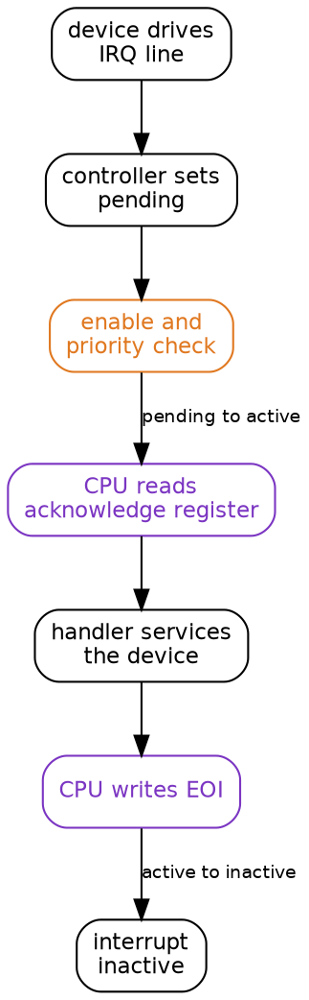
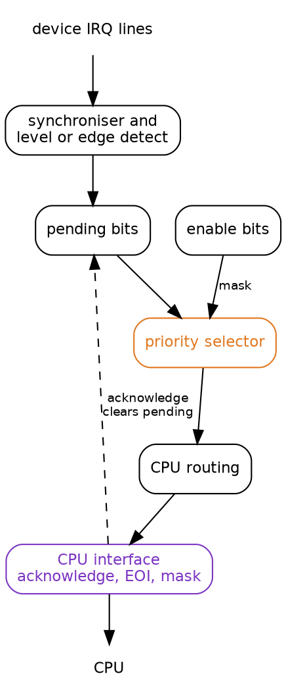
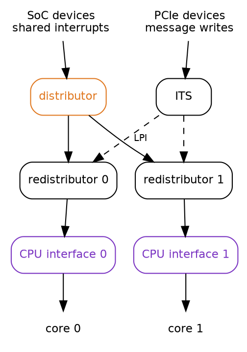

Title: SoC Intermediate 08: Interrupt controllers in depth
Date: 2026-11-20
Category: Engineering
Tags: SoC, Hardware, Electronics, RTL, Interrupts, GIC, NVIC, Arm
Slug: soc-intermediate-08-interrupt-controllers
Author: morganp
Summary: How an interrupt controller turns device events into ordered CPU exceptions, from pending and active state to priority, GIC routing and latency, and why acknowledging the controller does not silence the device.
Status: published

*Series: Intermediate SoC Design | Article 8 of 10*

---

## The handler that never returned

A timer expires, a UART (universal asynchronous receiver-transmitter) receives a byte, or a DMA (direct memory access) transfer completes, all while the CPU (central processing unit) runs unrelated code. The interrupt controller collects these requests and turns them into an ordered series of CPU exceptions.

A fault in that ordering seldom points at the controller. The serial console stopped echoing keys. The board still answered the debugger, and every halt landed in the same place: the UART interrupt handler. The interrupt counter for that line climbed by hundreds of thousands a second.

The handler did its job each time. It read the receive register, wrote EOI (end of interrupt) to the interrupt controller and returned. The interrupt fired again before the interrupted program ran a single instruction.

This article explains how an interrupt controller in an SoC (system on chip) records, masks, prioritises, routes and completes each request. It covers pending and active state, level and edge sensitivity, priority, the Arm NVIC and GIC, and interrupt latency.

---

## From a wire to an exception

A device requests attention by driving an IRQ (interrupt request) line. The interrupt controller sits between those lines and the CPU, and it tracks a state for every interrupt it owns.

| State | Meaning |
|---|---|
| Inactive | No request is outstanding |
| Pending | The controller has seen the request and the CPU has not accepted it |
| Active | The CPU has accepted the interrupt and its handler is running |
| Active and pending | The handler is running and a new request has arrived |

Two more controls decide whether a pending interrupt reaches the CPU. An enable bit for each interrupt masks it from delivery. A priority value orders it against the other pending interrupts.



The CPU acknowledges an interrupt by reading an acknowledge register. The read returns the interrupt number and moves the interrupt from pending to active. The handler services the device, and the EOI write tells the controller the handler has finished.

The active state stops the controller delivering the same interrupt twice while its handler runs. It also gives the controller a running priority to compare against each new request.

---

## Level and edge sensitivity

The controller samples each input in one of two ways, and the choice sets the meaning of a request.

A level-sensitive input reports a condition. The device holds the line high while the condition lasts, and the controller keeps the interrupt pending for as long as it sees the line high. Software ends the request by clearing the condition in the device.

An edge-sensitive input reports an event. The controller latches a rising edge into the pending bit and holds it there until the CPU acknowledges the interrupt. The line can fall straight away.

```wavedrom
{
  "signal": [
    {"name": "clk",          "wave": "P..........."},
    {"name": "level_irq",    "wave": "0.1....0...."},
    {"name": "edge_irq",     "wave": "0.10........"},
    {"name": "edge_pending", "wave": "0..1..0....."},
    {"name": "ack",          "wave": "0.....10...."}
  ],
  "head": {"text": "The level line stays high until software clears the device; the edge is latched until acknowledge"}
}
```

Level-sensitive interrupts recover from a missed request. If a handler returns with the condition still present, the line is still high and the interrupt fires again.

Edge-sensitive interrupts lose events in two ways. A second edge that arrives while the interrupt is already pending merges with the first, so a driver that counts interrupts undercounts events. A pulse narrower than one controller clock period can fall between two samples and never set the pending bit. The input synchroniser from [article I-05]({filename}../2026-10-03_SoC_Intermediate_05_Clock_Domain_Crossing/2026-10-03_SoC_Intermediate_05_Clock_Domain_Crossing.md) needs each pulse to last longer than that period.

Several devices can share one level-sensitive line, because the line stays high while any of them needs service. Each driver on a shared line reads its own device status first and returns at once when its device did not raise the request. Edge-sensitive lines do not share well, because an edge that arrives while the line is already high never appears.

### Two state machines, two acknowledgements

The UART in the opening drove a level-sensitive line. Its handler cleared the controller and left the device asserting.

A 16550-compatible UART raises one interrupt output for several causes: received data, an empty transmit buffer, and receiver line status errors such as an overrun. Each cause clears in a different way. A read of the receive buffer clears the received-data cause. Only a read of the line status register clears an overrun.

The handler read the receive buffer and never read the line status register. The overrun cause stayed set, so the UART kept its interrupt line high. When the CPU acknowledged, the controller still saw the line high, and the interrupt became active and pending. The EOI write ended the active state and left the interrupt pending, and the CPU took it again at once.

```wavedrom
{
  "signal": [
    {"name": "clk",       "wave": "P..........."},
    {"name": "irq_line",  "wave": "0.1........."},
    {"name": "ack_read",  "wave": "0...10..10.."},
    {"name": "gic_state", "wave": "2.3.4.3.4.3.", "data": ["inactive", "pending", "active+pending", "pending", "active+pending", "pending"]},
    {"name": "eoi_write", "wave": "0....10..10."}
  ],
  "head": {"text": "Device status never cleared: every EOI returns the interrupt to pending"}
}
```

An interrupt has state in two places, the device and the controller. The EOI write acknowledges the controller and says nothing to the device. A handler must clear the cause in the device first and write EOI second.

The fixed handler reads the UART interrupt identification register in a loop. It services each cause the register reports, and it writes EOI only when the register reports no interrupt pending.

---

## Inside the controller

A controller for a few dozen inputs has five parts, and larger controllers repeat the same parts at scale.



- Input logic synchronises each line and detects a level or an edge.
- Pending bits record requests, and software can also set or clear them through registers.
- Enable bits mask each interrupt.
- A priority selector picks the highest-priority interrupt that is both pending and enabled.
- Routing logic delivers the winner to one CPU or to a set of CPUs.

A flat compare across hundreds of priorities does not meet timing, so large controllers build the selector as a tree of comparators and pipeline it. The pipeline adds a few cycles of latency. It also means the best candidate can change between the signal to the CPU and the acknowledge read. A GIC answers that read with interrupt number 1023, the spurious interrupt, when nothing is pending by the time the read arrives.

### Priority and pre-emption

Arm controllers use a lower number for a higher priority. Take three pending interrupts:

| Interrupt | Device | Priority |
|---|---|---|
| 44 | Timer | `0x40` |
| 32 | Ethernet | `0x80` |
| 51 | UART | `0xA0` |

The controller delivers the timer first. If the timer fires while the Ethernet handler runs, it pre-empts that handler, because `0x40` beats the running priority of `0x80`. The UART waits behind both.

A controller implements only the upper bits of the 8-bit priority field. A Cortex-M part with 3 priority bits has 8 levels, from `0x00` to `0xE0` in steps of `0x20`, and the lower 5 bits read as zero.

Priority grouping splits the implemented bits into two fields. The upper field, the group priority, decides pre-emption. The lower field, the subpriority, orders interrupts inside one group that are pending at the same moment, and never causes pre-emption. A GIC sets the split with its binary point register, and a Cortex-M sets it with the `PRIGROUP` field.

Equal priorities cause latency surprises. Two interrupts at the same group priority never pre-empt each other, so a slow handler delays every other interrupt at its level for its full run time. Give every interrupt a defined reset priority, and assign the real values on purpose.

---

## Two controllers, two design points

### NVIC on Cortex-M

The NVIC (Nested Vectored Interrupt Controller) is part of the Cortex-M processor. It favours short, predictable latency over routing across many cores.

- A vector table in memory holds one handler address for each interrupt, so the core branches straight to the right handler.
- Hardware stacks eight registers on entry: R0 to R3, R12, the LR (link register), the PC (program counter) and xPSR, the program status register. A handler can be an ordinary C function.
- Tail-chaining starts the next pending handler without unstacking and restacking the registers in between.
- Late arrival lets a higher-priority interrupt that arrives during stacking take over the entry already in progress.

The NVIC has no EOI register. Exception return completes the interrupt: the handler returns by loading a special `EXC_RETURN` value into the PC, and the NVIC clears the active state. A Cortex-M3 or Cortex-M4 enters a handler in 12 cycles with zero-wait-state memory, and a tail-chain takes 6 cycles.

Software masks interrupts through two core registers. `PRIMASK` blocks every interrupt with a configurable priority. `BASEPRI`, from Armv7-M onwards, blocks every interrupt with a priority value equal to or greater than its own, so critical sections can leave the most urgent interrupts running.

### GIC on Cortex-A

The GIC (Generic Interrupt Controller) serves application-class SoCs with many cores. GICv3 splits it into three parts.



- The distributor holds the enable, priority and routing state of every shared interrupt.
- A redistributor for each core holds the state of that core's private interrupts, and it receives the interrupts the distributor routes to the core.
- The CPU interface in each core presents the highest-priority interrupt to the core. It holds the priority mask, the acknowledge register and the EOI register.

Software reaches the CPU interface through system registers. A handler reads `ICC_IAR1_EL1` to acknowledge an interrupt and get its number, then writes the same number to `ICC_EOIR1_EL1` when it finishes.

Interrupt numbers fall into four classes:

| Class | Numbers | Source |
|---|---|---|
| SGI (software-generated interrupt) | 0 to 15 | A write by one core to signal another core |
| PPI (private peripheral interrupt) | 16 to 31 | A device private to one core, such as its generic timer |
| SPI (shared peripheral interrupt) | 32 to 1019 | An SoC device wired to the distributor |
| LPI (locality-specific peripheral interrupt) | 8192 and up | A message write from a device |

A GIC shared peripheral interrupt has no connection to the SPI serial bus. The two terms share an acronym.

LPIs carry PCIe (Peripheral Component Interconnect Express) MSIs (message-signalled interrupts). The device writes an event identifier to the ITS (Interrupt Translation Service), and the ITS maps the device and event to an LPI number and a target redistributor. No wire connects the device to the controller.

Each shared interrupt has a routing register, `GICD_IROUTER`, that names one core by its affinity value or lets the distributor choose any one participating core. Route a device interrupt to the core that runs its driver, so the handler finds the driver data already in that core's cache. Linux exposes this choice as IRQ affinity.

A hypervisor owns the physical GIC. When a physical interrupt belongs to a guest, the hypervisor writes a virtual interrupt into a list register, `ICH_LR<n>_EL2`. The guest then acknowledges and completes the interrupt through a virtual CPU interface, without a trap to the hypervisor. GICv4 goes further and lets the ITS deliver virtual LPIs straight to a running guest.

---

## Where the latency goes

Interrupt latency runs from the device event to the first useful instruction of the handler. Each stage on the way adds to it:

1. The device logic detects the condition and drives its line.
2. The input synchroniser adds two or three controller clock cycles.
3. The priority selector picks the interrupt, and the CPU interface signals the core.
4. The core waits while interrupts are masked, or while a handler of equal or higher priority runs.
5. The core completes or abandons the current instruction and takes the exception.
6. The handler code and data miss in the cache and the TLB (translation lookaside buffer).
7. The OS (operating system) dispatches from its common entry code to the driver handler.

```wavedrom
{
  "signal": [
    {"name": "clk",          "wave": "P..........."},
    {"name": "device_event", "wave": "0.10........"},
    {"name": "irq_line",     "wave": "0..1.....0.."},
    {"name": "cpu_accept",   "wave": "0.....10...."},
    {"name": "handler",      "wave": "x......2..x.", "data": ["ISR"]},
    {"name": "gpio_marker",  "wave": "0......10..."},
    {"name": "latency",      "wave": "x.2....x....", "data": ["event to ISR"]}
  ],
  "head": {"text": "Latency runs from the device event to the first handler instruction"}
}
```

The hardware stages, 1 to 3, cost tens of cycles. Stages 4, 6 and 7 dominate on an application processor, and they vary from one event to the next. The worst case matters more than the average, because a deadline fails on one late event.

Measure latency on real hardware with a GPIO (general-purpose input/output) pin and a scope. Drive the interrupt source from a signal the scope can also see, set a GPIO pin high in the first line of the ISR (interrupt service routine), and measure the time between the two edges. Repeat for thousands of events with cold caches and a loaded OS, and record the maximum.

A timer does the same job inside the chip. Capture a free-running counter at the event, read the counter in the handler, and log the difference.

---

## Clearing order, and a checklist

Most interrupt bugs show one of two symptoms: the interrupt never arrives, or the CPU never leaves the handler.

| Cause | Symptom |
|---|---|
| Handler writes EOI and leaves the device status set | CPU never leaves the handler on a level-sensitive line |
| Handler clears the device and never writes EOI | The interrupt, and every interrupt at its priority or lower, never arrives again |
| Edge pulse narrower than one controller clock period | Interrupt arrives some of the time, or never |
| Driver on a shared line skips the check for its own device | The wrong driver claims the request and the real device stays asserted |
| Priority mask left at a level that blocks the interrupt | Interrupt never arrives |
| Interrupt routed to a core that is offline, or asleep without a wake path | Interrupt never arrives |
| Device reasserts the condition before the handler returns | Handler runs again at once, which is correct when there is new work |

Check a design against this list:

1. Document level or edge sensitivity for every interrupt.
2. Make device status bits write-one-to-clear, so software clears only the bits it handled.
3. Avoid read-to-clear status where two pieces of software can read the same register.
4. Define a reset priority for every interrupt and document the policy for changing it.
5. Clear the cause in the device before writing EOI.
6. Verify the pending, active and EOI sequence, including the active and pending state.
7. Test interrupts during reset, sleep and clock gating.
8. Measure latency with real cache and OS conditions, and record the worst case.
9. Require every driver on a shared line to identify its own device.

Before trusting a handler, find the line that clears the cause in the device, and check that it runs before the EOI write.

---

*Previous: [Article I-07: DMA controller architecture]({filename}../2026-10-17_SoC_Intermediate_07_DMA_Controller/2026-10-17_SoC_Intermediate_07_DMA_Controller.md)*
*Next: Intermediate Article 09, memory-mapped I/O and Linux device drivers*
